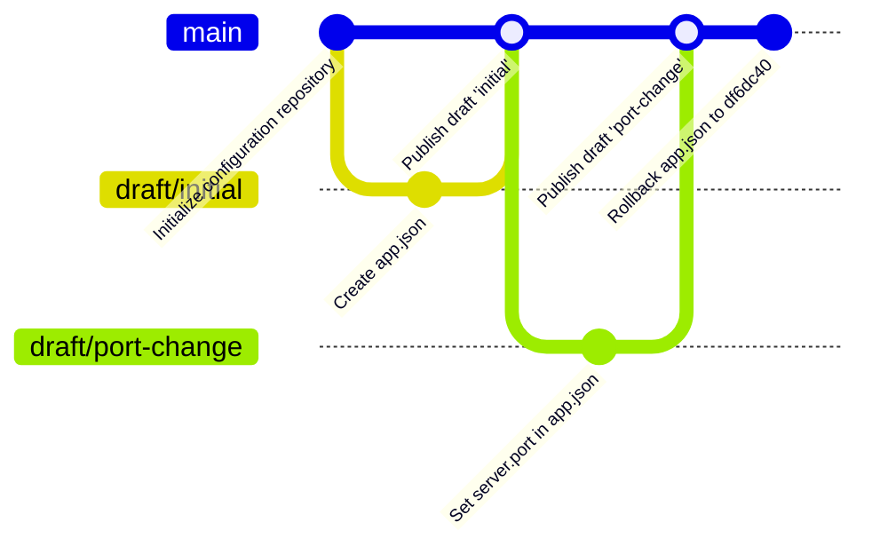

# gitconfig-cli

A command-line tool that uses a **Git repository as a versioned backend for
application configurations** (JSON and YAML). Every change is a commit,
changes are prepared on *draft* branches and *published* by merging them into
`main`, and any earlier version can be rolled back.

```text
$ gitconfig-cli set app.json server.port 9090 --draft new-port
Committed 3e39821: app.json server.port=9090

$ gitconfig-cli publish new-port
Published draft 'new-port' to 'main' (commit a06b776).
Changed: app.json
Draft branch 'draft/new-port' was deleted.
```

---

## Contents

- [Features](#features)
- [Installation](#installation)
- [Quick start: the full lifecycle](#quick-start-the-full-lifecycle)
- [The Git workflow](#the-git-workflow)
- [Command reference](#command-reference)
- [Merge conflicts](#merge-conflicts)
- [Audit trail and logging](#audit-trail-and-logging)
- [Exit codes](#exit-codes)
- [Architecture](#architecture)
- [Testing and coverage](#testing-and-coverage)
- [Development](#development)
- [Demo script (for the video walkthrough)](#demo-script-for-the-video-walkthrough)

---

## Features

- **Versioned configs**: JSON (`.json`) and YAML (`.yaml`, `.yml`) files, one
  commit per change, readable history per file.
- **Draft → publish branching strategy**: edits happen on `draft/<name>`
  branches; `publish` merges into `main` with a merge commit (or `--squash`).
- **Smart merge-conflict handling**:
  - edits to *different keys* that Git reports as a conflict (because they sit
    on neighbouring lines) are merged automatically, key by key;
  - real conflicts are reported **per key** with the base, main and draft
    values, `main` is left untouched, and the tool prints how to fix it;
  - `--prefer draft|main` settles conflicting keys automatically;
  - `draft sync` → edit → `resolve` for manual resolution, or `abort`;
  - `publish --dry-run` checks everything in a throw-away temporary clone.
- **Safe by construction**: refuses to run on a dirty working tree, validates
  every merged JSON/YAML file (and resets `main` if a merge would break one),
  rolls back half-finished edits, never rewrites history (rollback = new commit).
- **Managed `.gitignore`** in the configuration repository (editor backups,
  merge leftovers like `*.orig`, secrets such as `.env`, local overrides).
- **Structured audit trail**: every command and every action is logged as a
  JSON line (who, what, which repository, result, duration).
- **Remotes**: `clone`, `push` (main or a draft) and fast-forward `pull`.

## Installation

Requires **Python 3.11+** and **Git** on your `PATH`.

With Poetry (recommended for development):

```bash
git clone https://github.com/Victoire67/Git-Powered-Configuration-Management-CLI.git
cd Git-Powered-Configuration-Management-CLI
poetry install
poetry run gitconfig-cli --help
```

With pip:

```bash
pip install -r requirements.txt   # runtime dependencies (GitPython, click, PyYAML, structlog)
pip install .                     # installs the `gitconfig-cli` command
gitconfig-cli --version
```

You can also run it as a module: `python -m gitconfig_cli --help`.

Commits are made with your normal Git identity, so make sure it is set:

```bash
git config --global user.name  "Your Name"
git config --global user.email "you@example.com"
```

## Quick start: the full lifecycle

```bash
# 1. Create a configuration repository
gitconfig-cli --repo ./configs init
cd configs        # or keep passing --repo ./configs (or set GITCONFIG_REPO)

# 2. Create a draft configuration and publish it
gitconfig-cli create app.json --draft initial \
    --data '{"server": {"host": "localhost", "port": 8080}, "debug": false}'
gitconfig-cli publish initial --dry-run      # check first (optional)
gitconfig-cli publish initial
gitconfig-cli show app.json

# 3. Update it (the draft is created from main automatically)
gitconfig-cli set app.json server.port 9090 --draft port-change
gitconfig-cli draft diff port-change
gitconfig-cli publish port-change
gitconfig-cli history app.json

# 4. Roll back the last change
gitconfig-cli rollback app.json --steps 1
```

## The Git workflow



- **`main` holds the published configurations.** Applications read from it.
- **A draft is a branch named `draft/<name>`**, created from `main`
  (`draft create`, or automatically by the first write command).
- **Each change is one commit** on the draft (`create`, `set`, `unset`,
  `update`, `edit`, `delete`), with a descriptive default message.
- **Publishing merges the draft into `main`** with `--no-ff`, so every publish
  is a single merge commit on `main` and `history` lists *published versions*.
  `--squash` turns the whole draft into one ordinary commit instead. The draft
  branch is deleted afterwards (`--keep-draft` keeps it).
- **Rollback restores an old version as a new commit**, on `main` or on a
  draft (`--draft`). History is never rewritten, so a rollback can itself be
  rolled back.
- The tool **never touches uncommitted work**: if the working tree is dirty it
  stops and tells you. When it has to switch branches it always switches back,
  and if something fails half-way it discards its own partial edits.

## Command reference

Global options (before the command):

| Option | Env variable | Default | Meaning |
|---|---|---|---|
| `-C, --repo PATH` | `GITCONFIG_REPO` | `.` | Configuration repository to use |
| `--main-branch NAME` | `GITCONFIG_MAIN_BRANCH` | `main` | Branch holding published configs |
| `--log-file FILE` | `GITCONFIG_LOG_FILE` | `~/.gitconfig-cli/audit.log` | JSON audit trail |
| `--no-audit-log` | | | Do not write the audit file |
| `-v` / `-vv` | | | Show log events / also every Git call |

Reading commands accept `--draft NAME` (read a draft) or `--ref REF` (any
branch or commit); default is `main`. Writing commands take `--draft NAME`
(created from `main` if missing) and an optional `-m, --message`.

### Repository

| Command | Example | What it does |
|---|---|---|
| `init [PATH]` | `gitconfig-cli init` | Creates the repository on `main` with a README and a managed `.gitignore` |
| `clone URL [PATH]` | `gitconfig-cli clone git@github.com:team/configs.git` | Clones and creates local branches for all remote drafts |
| `status` | `gitconfig-cli status` | Current branch, drafts (ahead/behind main), merge in progress, local changes |

### Drafts

| Command | Example | What it does |
|---|---|---|
| `draft create NAME [--from REF]` | `gitconfig-cli draft create new-port` | Creates branch `draft/new-port` from `main` (or `REF`) |
| `draft list` | `gitconfig-cli draft list` | `new-port   2 ahead, 0 behind main` |
| `draft diff NAME` | `gitconfig-cli draft diff new-port` | Unified diff of what publishing would change |
| `draft sync NAME [--prefer draft\|main]` | `gitconfig-cli draft sync new-port` | Merges the latest `main` into the draft (see [conflicts](#merge-conflicts)) |
| `draft delete NAME [--force]` | `gitconfig-cli draft delete new-port --force` | Deletes the draft (`--force` if it has unpublished changes) |

### Configurations

| Command | Example | What it does |
|---|---|---|
| `list` | `gitconfig-cli list --draft new-port` | Lists configuration files |
| `show NAME [--key K] [--format raw\|json\|yaml]` | `gitconfig-cli show app.json --key server.port` | Prints a file, one value, or converts the format |
| `create NAME --draft D [--data JSON \| --from-file F] [--set K=V ...]` | `gitconfig-cli create db.yaml -d setup --set host=db --set pool.size=5` | Adds a new file; `--from-file` accepts JSON or YAML and converts |
| `set NAME KEY VALUE --draft D [--string]` | `gitconfig-cli set app.json server.port 9090 -d new-port` | Sets a dotted key; VALUE is parsed as JSON (`9090`, `true`, `[1,2]`) unless `--string` |
| `unset NAME KEY --draft D` | `gitconfig-cli unset app.json server.debug -d cleanup` | Removes a key |
| `update NAME --draft D (--data JSON \| --from-file F)` | `gitconfig-cli update app.json -d v2 --from-file new.json` | Replaces the whole content |
| `edit NAME --draft D` | `gitconfig-cli edit app.json -d tweak` | Opens `$EDITOR`, validates the result, commits it |
| `delete NAME --draft D [--yes]` | `gitconfig-cli delete old.json -d cleanup --yes` | Deletes the file (asks for confirmation) |

Dotted keys walk mappings by name and lists by index:
`database.replicas.0.host`.

### History and rollback

| Command | Example | What it does |
|---|---|---|
| `history NAME [-n N] [--all]` | `gitconfig-cli history app.json -n 5` | Published versions, newest first; `--all` also shows the commits made inside drafts |
| `rollback NAME --steps N` | `gitconfig-cli rollback app.json --steps 1` | Restores the version N publishes back, as a new commit |
| `rollback NAME --to REV [--draft D]` | `gitconfig-cli rollback app.json --to df6dc40 --draft undo` | Restores the version from a commit; works for deleted files too |

```text
$ gitconfig-cli history app.json
22cf0c0  2026-10-19 00:32:40  victoire67        Publish draft 'dave'
f9bac2f  2026-10-19 00:32:19  victoire67        Publish draft 'carol'
8cf9fad  2026-10-19 00:32:16  victoire67        Publish draft 'bob'
```

### Publishing and conflicts

| Command | Example | What it does |
|---|---|---|
| `publish NAME` | `gitconfig-cli publish new-port` | Merges the draft into `main` and deletes the draft |
| `publish NAME --dry-run` | `gitconfig-cli publish new-port --dry-run` | Performs the publish in a temporary clone and reports the outcome |
| `publish NAME --prefer draft\|main` | `gitconfig-cli publish new-port --prefer draft` | Settles keys changed on both sides in favour of one side |
| `publish NAME --squash [--keep-draft] [-m MSG]` | `gitconfig-cli publish v2 --squash -m "Release 2"` | One commit instead of a merge commit |
| `resolve [-m MSG]` | `gitconfig-cli resolve` | After fixing conflicted files: validates them and commits the merge |
| `abort` | `gitconfig-cli abort` | Cancels a merge in progress |

### Remotes and `.gitignore`

| Command | Example | What it does |
|---|---|---|
| `push [--draft D] [--remote R]` | `gitconfig-cli push --draft new-port` | Pushes `main` (or a draft) and sets the upstream |
| `pull [--remote R]` | `gitconfig-cli pull` | Fast-forwards `main` from the remote |
| `ignore list` | `gitconfig-cli ignore list` | Shows the managed `.gitignore` patterns |
| `ignore add PATTERN...` / `ignore remove PATTERN...` | `gitconfig-cli ignore add "*.secret"` | Edits the managed block and commits on `main` |

The tool only rewrites the block between
`# >>> managed by gitconfig-cli >>>` and `# <<< managed by gitconfig-cli <<<`;
anything you add outside it is kept.

## Merge conflicts

Two drafts started from the same `main`: Alice changed `server.host`, Bob
changed `server.port`. For Git these adjacent lines conflict; for the tool
they do not, because different keys were changed:

```text
$ gitconfig-cli publish bob
Published draft 'bob' to 'main' (commit 8cf9fad).
Changed: app.json
Automatically merged edits to different keys in: app.json
```

When both drafts change **the same key**, nothing is published and the tool
explains exactly what conflicts and how to proceed (exit code 3):

```text
$ gitconfig-cli publish dave
Error: Merge conflict merging 'draft/dave' into 'main': app.json
  CONFLICT in app.json
    server.port: base=7000  main=1111  draft=2222
'main' was not changed. To resolve the conflict, either:
  a) keep one side for the conflicting keys:
       gitconfig-cli publish dave --prefer draft   (use the draft's values)
       gitconfig-cli publish dave --prefer main    (keep main's values)
  b) or resolve by hand:
       gitconfig-cli draft sync dave     (bring main into the draft)
       edit the conflicted files, then
       gitconfig-cli resolve
       gitconfig-cli publish dave
```

Resolving by hand:

```text
$ gitconfig-cli draft sync dave
Error: Merge conflict merging 'main' into 'draft/dave': app.json
  CONFLICT in app.json
    server.port: base=7000  draft=2222  main=1111
The merge was left in progress on 'draft/dave' so you can fix it: ...

$ cat app.json                 # Git's conflict markers show both values
    "host": "alice.example",
<<<<<<< HEAD
    "port": 2222
=======
    "port": 1111
>>>>>>> main

$ $EDITOR app.json             # keep the value you want, remove the markers
$ gitconfig-cli resolve        # refuses while markers remain or JSON is invalid
Conflicts resolved (commit ecab1cb).
$ gitconfig-cli publish dave
```

While a merge is in progress every other write command is blocked with a
hint, so nothing can be committed on top of a half-merged file.

How it works: when Git stops with conflicts, the tool reads the three
versions of each conflicted file (common ancestor, `main`, draft), parses them
and merges them **key by key** (`config_merge.three_way_merge`). A key only
conflicts if both sides changed it to different values. `--prefer` is applied
per key too, never per text hunk, so the other side's neighbouring changes
are kept. Finally every merged configuration is parsed again; if a merge
would produce invalid JSON/YAML, `main` is reset to where it was.

## Audit trail and logging

Every invocation appends JSON lines to the audit file
(`~/.gitconfig-cli/audit.log` by default):

```json
{"action": "cli.command", "argv": ["publish", "bob"], "event": "started", "user": "victoire", "repo": "/work/configs", "level": "info", "logger": "gitconfig_cli.audit", "timestamp": "2026-10-18T22:32:16.101Z"}
{"action": "draft.publish", "draft": "bob", "commit": "8cf9fad...", "files": ["app.json"], "auto_resolved": ["app.json"], "draft_deleted": true, "event": "published", ...}
{"action": "draft.publish", "draft": "bob", "duration_ms": 412.3, "event": "succeeded", ...}
```

Each action logs `started`, then `succeeded` or `failed` (with `error_type`
and `error`). Dry runs are tagged `"dry_run": true`. Use `-v` to see events
on the console and `-vv` to also see every Git command that is run.

## Exit codes

| Code | Meaning |
|---|---|
| `0` | Success |
| `1` | Error (invalid repository, missing draft/config, dirty tree, Git failure, invalid content...) |
| `2` | Invalid command-line usage |
| `3` | Merge conflict (publish, `publish --dry-run`, or `draft sync`) |

## Architecture

The code follows SOLID principles: Git logic and configuration parsing are
separate, and the application logic depends only on abstractions.

```text
cli.py ──► ConfigManager (manager.py) ──► VersionControl   (abstractions.py)
  │              │                         ▲ implemented by GitRepository (git_repository.py, GitPython)
  │              ├──► ConflictResolver ────┤
  │              │    (conflicts.py)       ▼
  │              └──────────────────────► ConfigSerializer (abstractions.py)
  ▼                                        ▲ implemented by ConfigParser (config_parser.py, JSON/YAML)
output.py (formatting only)
```

| Module | Responsibility |
|---|---|
| `abstractions.py` | `VersionControl` and `ConfigSerializer` interfaces (ABCs) |
| `git_repository.py` | `GitRepository`: the only module that imports GitPython; context managers `checked_out()` and `temporary_clone()` |
| `config_parser.py` | `ConfigParser` choosing a `JsonFormat`/`YamlFormat` strategy by extension (open for new formats) |
| `manager.py` | `ConfigManager`: drafts, edits, history, rollback, publish, sync/resolve/abort |
| `config_merge.py` | Pure key-by-key three-way merge |
| `conflicts.py` | `ConflictResolver`: analyses Git conflicts and resolves what it can |
| `keypath.py` | Dotted key access (`a.b.0.c`) on nested data |
| `gitignore.py` | Pure rendering of the managed `.gitignore` block |
| `models.py` | Immutable dataclasses passed between layers |
| `exceptions.py` | `GitConfigError` hierarchy: `ConfigNotFound`, `MergeConflictError`, `InvalidRepoError`, ... |
| `logging_config.py` | structlog setup, `audit()` context manager |
| `output.py` | Text rendering of results, errors, hints and conflict guidance |
| `cli.py` | Click commands, `ManagerFactory`, error handling and exit codes |

## Testing and coverage

```bash
poetry run pytest              # runs all tests with branch coverage (fails under 95%)
poetry run pytest --no-cov -k conflict   # a subset, without the coverage gate
```

- **Temporary Git repositories**: fixtures in `tests/conftest.py` create a
  fresh repository for every test (`empty_repo_path`, `repo`, `config_repo`)
  and isolate Git from your own settings (private global config, fixed
  identity, no system config).
- **Git state assertions**: tests drive the tool and then inspect branches,
  commit parents, messages and file contents directly with GitPython.
- **Conflict scenarios** are created on purpose (`tests/test_merge_conflicts.py`):
  neighbouring-line edits, same-key edits, delete-vs-modify, squash, manual
  resolution, dry runs.
- **Mocks for failures** that should not touch Git or the network: a rejected
  push, a failing commit, a missing identity (`tests/test_manager_mocked.py`,
  `tests/test_git_repository.py`, `tests/test_cli.py`). Because the manager
  depends on `VersionControl`, it can run against `create_autospec(VersionControl)`.
- **Coverage**: 100% line and branch coverage. The report is in
  [`reports/coverage.txt`](reports/coverage.txt); an HTML report is written to
  `htmlcov/` on every run.

## Development

```bash
poetry install
poetry run pre-commit install         # black, ruff, mypy + whitespace hooks on every commit
poetry run pre-commit run --all-files
poetry run black . && poetry run ruff check . && poetry run mypy src
```

`mypy` runs in strict mode, ruff enforces import order and modern idioms, and
all public functions have Google-style docstrings. CI
(`.github/workflows/ci.yml`) runs the same checks and the tests on Python
3.11, 3.12 and 3.13.

Project layout:

```text
src/gitconfig_cli/     application package (see Architecture)
tests/                 pytest suite (fixtures in conftest.py)
reports/coverage.txt   latest coverage report
requirements*.txt      pip installation (pinned like poetry.lock)
pyproject.toml         metadata, dependencies and tool configuration
```

## Demo script (for the video walkthrough)

A sequence that shows the full lifecycle: draft, publish, update, conflict,
resolution, rollback.

```bash
gitconfig-cli -C demo init && cd demo

# create a draft config and publish it
gitconfig-cli create app.json -d initial --data '{"server": {"host": "localhost", "port": 8080}}'
gitconfig-cli draft list
gitconfig-cli publish initial --dry-run
gitconfig-cli publish initial

# update it
gitconfig-cli set app.json server.port 9090 -d port-change
gitconfig-cli draft diff port-change
gitconfig-cli publish port-change
gitconfig-cli history app.json

# two teammates: different keys -> merged automatically
gitconfig-cli draft create alice && gitconfig-cli draft create bob
gitconfig-cli set app.json server.host alice.example -d alice
gitconfig-cli set app.json server.port 7000 -d bob
gitconfig-cli publish alice && gitconfig-cli publish bob

# same key -> real conflict, reported and resolved
gitconfig-cli draft create carol && gitconfig-cli draft create dave
gitconfig-cli set app.json server.port 1111 -d carol
gitconfig-cli set app.json server.port 2222 -d dave
gitconfig-cli publish carol
gitconfig-cli publish dave                 # conflict report + guidance
gitconfig-cli draft sync dave              # leaves the merge for you
gitconfig-cli status
#   edit app.json, keep one port value, remove the markers
gitconfig-cli resolve
gitconfig-cli publish dave

# roll back and inspect
gitconfig-cli rollback app.json --steps 1
gitconfig-cli show app.json
git log --oneline --graph --all
```
